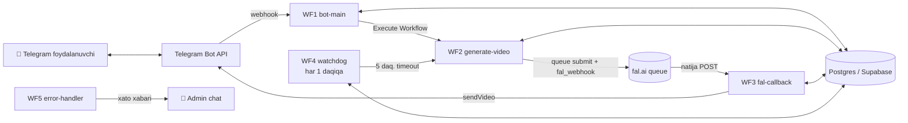
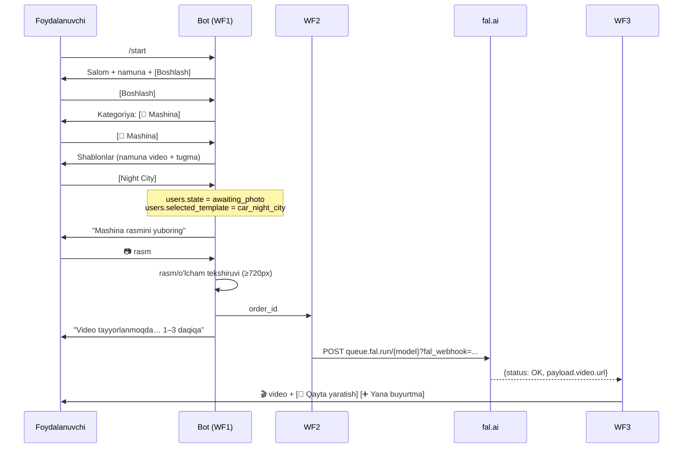

# 1-bosqich: MVP — n8n workflow tuzilmasi

**Maqsad:** bot + 🚗 Mashina kategoriyasi + 2 ta shablon (`car_night_city`, `car_orbit`) + fal.ai.
To'lov yo'q, faqat admin (siz) uchun test. Bot faqat `ADMIN_CHAT_ID`ga javob beradi.

---

## 1. Umumiy arxitektura



Nega 5 ta alohida workflow:
- **Webhook (callback) usuli** — fal.ai video tayyor bo'lganda o'zi bizga POST qiladi. n8n 1–3 daqiqa
  "Wait" bilan band bo'lib turmaydi, parallel buyurtmalar bir-birini to'sib qo'ymaydi.
- Har bir qism alohida sinaladi va almashtiriladi (masalan 3-bosqichda faqat WF1 ga to'lov qo'shiladi).

---

## 2. MVP foydalanuvchi oqimi



---

## 3. Node-ma-node tavsif

### WF1 — `bot-main` (Telegram bilan muloqot)

| # | Node | Turi | Vazifasi |
|---|------|------|----------|
| 1 | **Telegram Trigger** | `Telegram Trigger` | Updates: `message`, `callback_query`. Bot uchun yagona webhook. |
| 2 | **Normalize** | `Code` | Update'dan `chat_id`, `user_id`, `username`, `type` (`command` / `callback` / `photo` / `document` / `text`), `data` (callback_data), `photo` (eng katta o'lcham: `file_id`, `width`, `height`) ni bitta tekis obyektga yig'adi. |
| 3 | **Admin-only (MVP)** | `IF` | `chat_id == $env.ADMIN_CHAT_ID`. Aks holda — "Bot tez orada ishga tushadi" va to'xtaydi. 3-bosqichda olib tashlanadi. |
| 4 | **Upsert user** | `Postgres` | `INSERT … ON CONFLICT (telegram_id) DO UPDATE` — foydalanuvchini yaratadi/yangilaydi, `state` va `selected_template` ni qaytaradi. |
| 5 | **Router** | `Switch` | `type` + `data` bo'yicha yo'naltiradi: `/start`, `cb:start`, `cb:cat:*`, `cb:tpl:*`, `photo`, `document`, `cb:regen:*`, `cb:new`, boshqa. |
| 6a | **/start** | `Telegram → sendVideo` | Namuna video (`SAMPLE_VIDEO_FILE_ID`) + matn `texts.start` + `[Boshlash]`. |
| 6b | **Kategoriyalar** | `Telegram → sendMessage` | Inline tugmalar: `cb:cat:car` (MVP'da faqat mashina). |
| 6c | **Shablonlar ro'yxati** | `Postgres` → `Code` → `Telegram` | `SELECT * FROM templates WHERE category=$1 AND active`. Har biri uchun namuna video (`sample_file_id`) + `[Tanlash]` tugmasi (`cb:tpl:<id>`). |
| 6d | **Shablon tanlandi** | `Postgres` → `Telegram` | `users.state='awaiting_photo'`, `selected_template=<id>`. Matn `texts.send_photo`. |
| 6e | **Rasm keldi** | `IF state=awaiting_photo` → `Code (validate)` | Tekshiruv: `photo` bormi; `max(width,height) ≥ MIN_IMAGE_SIDE` (720). `document` sifatida kelsa — `mime_type` `image/*` bo'lishi shart. Xato → `texts.err_small` / `texts.err_not_image`. |
| 6f | **Faol buyurtma bormi** | `Postgres` | `SELECT 1 FROM orders WHERE user_id=$1 AND status IN ('generating')` → bor bo'lsa `texts.err_active_order`. |
| 6g | **Buyurtma yaratish** | `Postgres` | `INSERT INTO orders (... status='generating') RETURNING id`; `users.state='idle'`. |
| 6h | **"Tayyorlanmoqda"** | `Telegram → sendMessage` | `texts.generating`. `message_id` saqlanadi (keyin o'chirish uchun). |
| 6i | **Generatsiyani chaqirish** | `Execute Workflow` | WF2 ni `order_id` bilan chaqiradi, **"Wait for completion" = off** (bot darhol javob beradi). |
| 6j | **Qayta yaratish** | `Postgres` → `IF regen_used=false` → `Execute Workflow` | `regen_used=true`, `attempt=0`, `status='generating'`; WF2 ni qayta chaqiradi. Tugma xabardan olib tashlanadi (`editMessageReplyMarkup`). |
| 6k | **Yana buyurtma** | → 6b ga | Kategoriyalarni qayta ko'rsatadi. |
| 7 | **answerCallbackQuery** | `Telegram` | Har bir callback'dan keyin tugmadagi "soat" belgisini o'chiradi. |

### WF2 — `generate-video` (fal.ai'ga yuborish)

| # | Node | Turi | Vazifasi |
|---|------|------|----------|
| 1 | **Execute Workflow Trigger** | `Execute Workflow Trigger` | Kirish: `{ order_id }`. |
| 2 | **Load order** | `Postgres` | `orders JOIN templates` — prompt, negative_prompt, duration, `photo_file_id`, `attempt`. |
| 3 | **Telegram getFile** | `Telegram → File: Get` (download=on) | `file_id` → binary rasm. |
| 4 | **Rasmni fal'ga tayyorlash** | `Code` | MVP: binary → `data:image/jpeg;base64,...` (fal.ai Data URI qabul qiladi, alohida storage shart emas). 5-bosqichda Supabase Storage'ga o'tamiz (oldin/keyin juftlik uchun baribir kerak). ⚠️ `api.telegram.org/file/bot<TOKEN>/…` URL'ni fal'ga **bermaymiz** — unda bot tokeni bor. |
| 5 | **Build payload** | `Code` | Modelga qarab body yasaydi (pastdagi 4-bo'lim). |
| 6 | **fal submit** | `HTTP Request` | `POST https://queue.fal.run/{{$env.FAL_MODEL}}?fal_webhook={{$env.N8N_PUBLIC_URL}}/webhook/fal-callback?secret=...` Header: `Authorization: Key {{$env.FAL_KEY}}`. Javob: `request_id`. |
| 7 | **Save request** | `Postgres` | `fal_request_id`, `attempt=attempt+1`, `submitted_at=now()`. |
| — | *Xato chiqishi* | `HTTP Request → On Error: Continue (error output)` | Submit'ning o'zi xato bersa → WF3 dagi "xato" tarmog'i bilan bir xil mantiq (retry yoki fail). |

### WF3 — `fal-callback` (natijani qabul qilish)

| # | Node | Turi | Vazifasi |
|---|------|------|----------|
| 1 | **Webhook** | `Webhook` (POST `/fal-callback`) | fal.ai natijasi. `Respond: Immediately` (200). |
| 2 | **Verify** | `IF` | `query.secret == $env.FAL_WEBHOOK_SECRET` (oddiy himoya; keyinroq fal'ning ED25519 imzosini tekshirish qo'shiladi). |
| 3 | **Find order** | `Postgres` | `WHERE fal_request_id = body.request_id AND status='generating'`. Topilmasa (masalan timeout'dan keyin kech kelgan) — e'tiborsiz qoldiriladi. |
| 4 | **OK / ERROR** | `IF` | `body.status == 'OK'` va `body.payload.video.url` bor. |
| 5a | **Video yuborish** | `Telegram → sendVideo` | `video = payload.video.url` (Telegram URL'dan o'zi yuklaydi, ≤20 MB). Caption `texts.done`. Tugmalar: `[🔁 Qayta yaratish]` (faqat `regen_used=false` bo'lsa) + `[➕ Yana buyurtma]`. |
| 6a | **Done** | `Postgres` | `status='done'`, `video_url`, `video_file_id` (Telegram javobidan), `api_cost_usd += FAL_COST_PER_VIDEO`. |
| 7a | **"Tayyorlanmoqda" ni o'chirish** | `Telegram → deleteMessage` | Ixtiyoriy, chat toza turadi. |
| 5b | **Retry kerakmi** | `IF attempt < 2` | Ha → WF2 ni qayta chaqiradi (avtomatik 1 marta qayta urinish). |
| 6b | **Failed** | `Postgres` + `Telegram ×2` | `status='failed'`, `error_text`; foydalanuvchiga `texts.err_generation`; admin'ga `order_id`, xato matni. |

### WF4 — `watchdog` (timeout)

| # | Node | Turi | Vazifasi |
|---|------|------|----------|
| 1 | **Schedule Trigger** | har 1 daqiqa | |
| 2 | **Stuck orders** | `Postgres` | `status='generating' AND submitted_at < now() - interval '5 min'` (`GEN_TIMEOUT_MIN`). |
| 3 | **Loop** | → WF3 ning 5b tarmog'i | Xuddi fal xatosi kabi: `attempt<2` → qayta urinish, aks holda `failed` + admin xabari. Mantiq takrorlanmasligi uchun 5b–6b alohida kichik sub-workflow `handle-failure` qilib chiqariladi. |

### WF5 — `error-handler`

| # | Node | Turi | Vazifasi |
|---|------|------|----------|
| 1 | **Error Trigger** | `Error Trigger` | WF1–WF4 ning *Settings → Error workflow* maydoniga shu workflow qo'yiladi. |
| 2 | **Admin xabari** | `Telegram` | Workflow nomi, node, xato matni, execution havolasi. |

---

## 4. fal.ai — tekshirilgan endpoint'lar (fal.ai hujjatlaridan)

| Model | `FAL_MODEL` qiymati | `duration` | `negative_prompt` | Narx (taxm.) |
|-------|---------------------|------------|-------------------|--------------|
| Kling 2.5 Turbo Pro | `fal-ai/kling-video/v2.5-turbo/pro/image-to-video` | `"5"` / `"10"` | ✅ bor | ~$0.35 / 5s |
| Hailuo 2.3 Standard (768p) | `fal-ai/minimax/hailuo-2.3/standard/image-to-video` | `"6"` / `"10"` | ❌ yo'q (`prompt_optimizer` bor) | ~$0.28 / 6s |

Ikkalasida ham majburiy: `prompt`, `image_url`. Natija: `{ "video": { "url": "…mp4" } }`.

**Build payload** (`Code` node) model almashsa avtomatik moslashadi:

```js
const model = $env.FAL_MODEL;
const t = $json; // order + template
const body = { prompt: t.prompt, image_url: t.image_data_uri };
if (model.includes('kling')) {
  body.duration = '5';
  body.negative_prompt = t.negative_prompt;
  body.cfg_scale = 0.5;
} else if (model.includes('hailuo')) {
  body.duration = '6';            // Hailuo 5s ni qo'llamaydi
  body.prompt_optimizer = false;  // shablon prompti o'zgarmasin
}
return [{ json: { body } }];
```

Model almashtirish = `.env` da bitta qator: `FAL_MODEL=...` va n8n'ni restart.

---

## 5. MVP uchun minimal baza (to'liq sxema 4-bosqichda)

MVP'dayoq Postgres ishlatamiz — keyin qayta yozmaslik uchun. Kerakli jadvallar:
`users (telegram_id, username, lang, state, selected_template, created_at)`,
`templates (...)`, `orders (id, user_id, template_id, photo_file_id, status, fal_request_id, attempt, submitted_at, video_url, video_file_id, regen_used, api_cost_usd, error_text, created_at)`.

Shablonlar `config/templates.json` dan bazaga yuklanadi; yangi shablon qo'shish = JSON'ga yozish (yoki Supabase jadvalida qator qo'shish), kod o'zgarmaydi.

---

## 6. MVP'da hali yo'q (keyingi bosqichlarga)

| Funksiya | Bosqich | Izoh |
|----------|---------|------|
| To'lov (Click/Payme) | 3 | `orders.status` ga `awaiting_payment` / `paid` qo'shiladi, WF1 da 6g va 6i orasiga to'lov qadami. |
| Xira/qorong'i rasm tekshiruvi | 5 | n8n `Code` node'ida tasvir tahlili kutubxonasi yo'q. Variant: `Edit Image → Information` (GraphicsMagick) yoki kichik moderatsiya modeli. |
| Moderatsiya, portret, rozilik | 5 | Kling/Hailuo'da `enable_safety_checker=true` (default) MVP'da himoya beradi. |
| `/stats`, `/broadcast` | 4 | |
| Rus tili | 6 | `texts` faylida `ru` bo'limi. |
