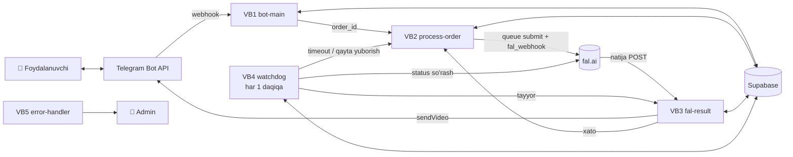
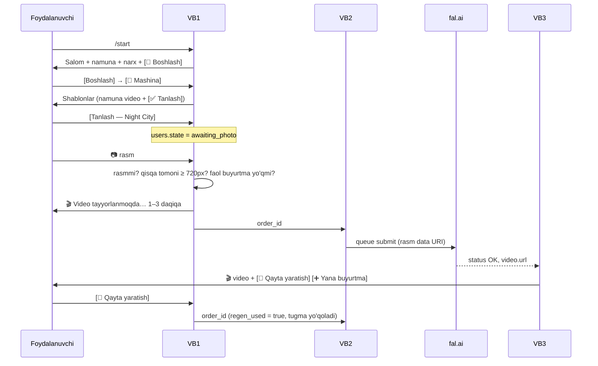

# 1-bosqich: MVP — n8n workflow tuzilmasi

**Maqsad:** bot + 🚗 Mashina + 2 shablon (`car_night_city`, `car_orbit`) + fal.ai. To'lov yo'q.
Bot faqat `ADMIN_CHAT_ID` va `ALLOWED_USER_IDS` ga javob beradi (`BOT_PUBLIC=false`).

Workflow JSON'lari: [`workflows/`](../workflows) · O'rnatish: [02-setup.md](02-setup.md)

---

## 1. Arxitektura

| Workflow | Trigger | Vazifasi |
|----------|---------|----------|
| **VB1 bot-main** | Telegram Trigger | Barcha xabar va tugmalar: menyu, shablon tanlash, rasm tekshiruvi, buyurtma yaratish, qayta yaratish |
| **VB2 process-order** | Boshqa workflow'dan | fal.ai'ga yuborish, qayta urinish yoki `failed` + foydalanuvchiga uzr + admin'ga xabar |
| **VB3 fal-result** | Webhook `/webhook/fal-result` + VB4'dan | Videoni yetkazish yoki xatoni VB2'ga qaytarish |
| **VB4 watchdog** | Har 1 daqiqa | Webhook kelmay qolsa fal.ai'dan holatni o'zi so'raydi; 5 daqiqalik timeout; yuborilmay qolganlarni qayta yuboradi |
| **VB5 error-handler** | Error Trigger | n8n'dagi har qanday kutilmagan xato → admin'ga |

**Nega webhook + watchdog:** fal.ai tayyor bo'lganda o'zi bizga POST qiladi. n8n 1–3 daqiqa kutib band
bo'lib turmaydi va parallel buyurtmalar bir-birini to'smaydi. Quick tunnel URL'i almashsa, webhook yo'qolishi
mumkin. Bunday holatda watchdog fal.ai'dan natijani o'zi oladi, shuning uchun buyurtma yo'qolmaydi.

---

## 2. Foydalanuvchi oqimi

---

## 3. Node-ma-node

### VB1 bot-main
| Node | Turi | Vazifasi |
|------|------|----------|
| Telegram Trigger | Telegram Trigger | `message`, `callback_query` |
| Normalize | Code | Update → `{chat_id, user_id, kind, text, cb_data, photo{file_id,width,height}, doc}`. Guruh chatlari e'tiborsiz qoldiriladi |
| Context | Postgres | Foydalanuvchini upsert qiladi + `bot_texts` + `settings` ni bitta so'rovda oladi |
| Router | Code | Barcha qarorlar shu yerda: kirish cheklovi, /start, menyu, rasm tekshiruvi. Natija: tayyor Telegram javoblari (`route=reply`) yoki DB qadami |
| Route | Switch | `reply` · `list_templates` · `select_template` · `create_order` · `regen` |
| Templates → Build template list | Postgres → Code | Faol shablonlar; `sample_file_id` bo'lsa namuna video + tugma |
| Set template → Build ask photo | Postgres → Code | `state=awaiting_photo`; kategoriyaga mos ko'rsatma (portretda "faqat o'zingiz" ogohlantirishi) |
| Create order → Build order reply / Order created? | Postgres → Code / IF | Atomik: shablon faolmi + faol buyurtma yo'qmi → `INSERT`. Javob: "tayyorlanmoqda" yoki "faol buyurtmangiz bor" |
| Start regen → Build regen reply / Regen started? | Postgres → Code / IF | Faqat egasi, faqat `done`, faqat 1 marta. Eski xabardagi 🔁 tugmasi olib tashlanadi |
| Run process-order | Execute Workflow | VB2 ni kutmasdan chaqiradi |
| Send TG | HTTP Request | Universal `POST /bot<TOKEN>/<method>`. Ketma-ket (batch=1), xatoda to'xtamaydi |

### VB2 process-order (kirish: `{order_id, error?}`)
| Node | Vazifasi |
|------|----------|
| Load order | Buyurtma + shablon + sozlamalar + matnlar |
| Decide / Action | `submit` yoki `fail`. Fail sharti: xato bor va `attempt >= max_attempts` (default 2, ya'ni 1 ta avtomatik qayta urinish) |
| Start attempt | `attempt + 1` **optimistik qulf bilan** (`WHERE attempt = $2`): webhook va watchdog bir vaqtda kelsa ham fal.ai'ga ikki marta yuborilmaydi |
| TG getFile → TG download | Rasmni Telegram'dan binary qilib oladi |
| Build fal request | data URI (bot tokeni fal'ga ketmaydi) + modelga mos body + `fal_webhook` |
| fal submit | `POST queue.fal.run/{FAL_MODEL}` → `request_id`, `status_url`, `response_url` saqlanadi. Xato bo'lsa `error_text` yoziladi va watchdog 60 soniyada qayta yuboradi |
| Mark failed → Build fail messages → Send TG | `status=failed`, foydalanuvchiga uzr + [➕ Yana buyurtma], admin'ga buyurtma raqami va xato matni |

### VB3 fal-result
| Node | Vazifasi |
|------|----------|
| fal webhook / From watchdog → Normalize | `?secret=` tekshiriladi (faqat webhook uchun), so'ng natija `{request_id, ok, video_url, error}` ko'rinishiga keltiriladi |
| Claim done | Atomik `generating → done` **faqat joriy `fal_request_id` uchun**. Eski urinishning kech kelgan natijasi va takroriy webhook e'tiborsiz qoldiriladi |
| Build video message → Send video → Save file_id | Video + tugmalar; Telegram `file_id` saqlanadi (Instagram to'plami uchun) |
| Delivery failed? → alert | Telegram videoni ololmasa, admin'ga havola yuboriladi |
| Find order → Run process-order | Xato bo'lsa VB2'ga qaytadi (retry yoki fail) |

### VB4 watchdog
| Holat (`kind`) | Shart | Harakat |
|----------------|-------|---------|
| `poll` | yuborilganiga > 60 s | `GET status_url` → `COMPLETED` bo'lsa natijani olib VB3'ga beradi; `gen_timeout_min` (5) oshgan bo'lsa → VB2 `timeout` |
| `resubmit` | submit xato bergan | VB2 (qayta urinish yoki fail) |
| `stuck` | 2 daqiqada ham yuborilmagan | VB2 |

---

## 4. fal.ai modellari (fal.ai hujjatlaridan tekshirilgan)

| Model | `FAL_MODEL` | `duration` | `negative_prompt` | Narx (taxm.) |
|-------|-------------|------------|-------------------|--------------|
| Kling 2.5 Turbo Pro | `fal-ai/kling-video/v2.5-turbo/pro/image-to-video` | `5` / `10` | ✅ | ~$0.35 / 5s |
| Hailuo 2.3 Standard 768p | `fal-ai/minimax/hailuo-2.3/standard/image-to-video` | `6` / `10` | ❌ (`prompt_optimizer=false` qo'yiladi) | ~$0.28 / 6s |

Model almashtirish: `deploy/.env` → `FAL_MODEL=…` va `FAL_COST_PER_VIDEO_USD=…`, so'ng `docker compose up -d n8n`.
Ikkala modelda ham fal'ning `enable_safety_checker` filtri default holatda yoqilgan.

---

## 5. Sozlash — kod yozmasdan (Supabase → Table Editor)

| Jadval | Nima o'zgaradi |
|--------|----------------|
| `settings` | `price_uzs`, `enabled_categories`, `sample_video_file_id`, `min_image_side`, `max_attempts`, `gen_timeout_min`, `default_negative_prompt` |
| `templates` | Yangi shablon = yangi qator; `active` bilan yoqish/o'chirish; `sample_file_id` = namuna video |
| `bot_texts` | Barcha bot matnlari (`uz`, `ru`) |

Namuna videoning `file_id` sini olish uchun admin botga video yuboradi, bot `file_id` ni qaytaradi.

Asl manbalar `config/*.json` da turadi. `python3 scripts/build.py` ulardan `sql/002_seed.sql` ni qayta yasaydi.

---

## 6. MVP'da hali yo'q

| Funksiya | Bosqich |
|----------|---------|
| To'lov (Click/Payme) — `Create order` statusi `awaiting_payment` bo'ladi | 3 |
| `/stats`, `/broadcast`, shablonni bot ichidan yoqish/o'chirish | 4 |
| Xira/qorong'i rasm tekshiruvi, moderatsiya, portret, rozilik tugmasi, oldin/keyin to'plami | 5 |
| Rus tili (`bot_texts.ru`) | 6 |
